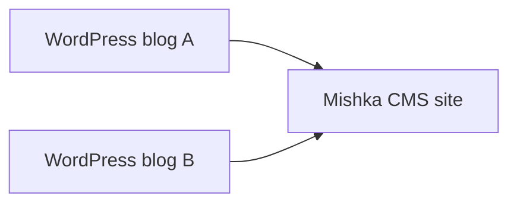

<div align="center">

[](https://www.buymeacoffee.com/mishkagroup)
[](https://github.com/sponsors/mishka-group)

# Mishka CMS Migration

**A migration extension for [Mishka CMS](https://mishka.tools/cms): move a WordPress site into it.**

[Mishka CMS](https://mishka.tools/cms) · [Hire us](https://mishka.tools/hire-us)

</div>

## 📖 What is Mishka CMS Migration?

`mishka_cms_migration` is the migration extension of [Mishka CMS](https://mishka.tools/cms). It moves a site from another CMS into a Mishka CMS site: blog posts, categories, tags and authors, pages, media, redirects, site settings, and the global colours and fonts of a site built with Elementor (as theme tokens in a stylesheet of its own, with a dark-theme twin of each colour). Every record is written by the CMS's own actions as the admin who pressed Import, so the CMS's policies and validations decide, and plugins that react to a change (sitemap, share cards, stylesheet) react as usual.

- [x] **WordPress**, over its REST API or from the file its Tools ▸ Export makes, with Polylang and WPML translations and Elementor layouts
- [ ] Joomla
- [ ] Drupal
- [ ] Ghost

## 🔌 In a host

1. Add `MishkaCmsMigration` to the host's `ash_domains` and run `mix ash.codegen` for the runs and items tables.
2. Give Oban a `migration` queue (`queues: [migration: 1]`).
3. Install the extension on a site from the CMS's installer, then grant the `admin:dashboard:migration` and `admin:api:migration` permissions to the site's admin.

Posts, authors, categories and tags are written into [Mishka Blog](https://mishka.tools/cms/extensions/blog) when it runs beside the extension, and skipped when it does not.

## 🔁 How a migration runs

1. An admin creates a run: the source, the host it reads from, how to connect, and their choices.
2. A dry run reports what an import would create, update and skip. It writes nothing.
3. The admin decides on the Items page: leave items out, map a category or tag to one the site has, or settle each conflict marked "Needs your decision".
4. The import writes each item through the CMS's own actions as that admin, and saves the report.

Both steps are AshOban jobs on the `migration` queue. Running again is a new run: it updates what the source changed and keeps what an admin changed in the CMS.

## 🔀 Several sources into one site

- 🌍 One site can take content from many sources, such as two WordPress blogs.
- 🧾 Each item is remembered per site, host, kind and source id, so the same id on two hosts is two items.
- 🛡️ A clash in the CMS, such as the same address, fails that item with the CMS's reason. Nothing is overwritten.



## 🗂️ Layout

The extension is an Ash domain with three resources: a run, its items and its log. Sources and targets are Mishka Installer plugins, and the admin screens are mishka_gervaz. The tests replay responses recorded from a real WordPress.

<details>
<summary>Folders and files that matter</summary>

```
lib/
├── mishka_cms_migration.ex       the Ash domain and its code interfaces
├── mishka_cms_migration/
│   ├── resources/                MigrationRun, MigrationItem and MigrationLog
│   ├── sources/                  the WordPress source (REST and export file) and how its content becomes HTML
│   ├── targets/                  one module per kind written: pages, media, redirects, settings,
│   │                             stylesheet, layout, and the Blog's bloggers, collections, tags, posts, comments
│   ├── workers/                  what a job does: the walk, the decision, the write, who it runs as
│   ├── source.ex, target.ex      the behaviours a source and a target follow
│   ├── events.ex                 migration:content:convert, migration:item:before_import, migration:import:finished
│   ├── provision.ex              installing on a site: its permissions
│   └── report.ex                 what a dry run or an import did with each item
└── mishka_cms_migration_web/     the admin: runs page, items page, routes and sidebar entry
test/                             behaviour tests, support plugins and the recorded WordPress fixtures
dev/
├── playground.exs                `mix playground`: a run walked through by hand
└── wordpress/                    a real WordPress in Docker, and the scripts that seed and record it
```

</details>

## 🧩 Part of Mishka CMS

Mishka CMS Migration is an extension of [Mishka CMS: Open-Source Multi-Site CMS](https://mishka.tools/cms), built like [Mishka Blog: Open-Source Blog Engine](https://mishka.tools/cms/extensions/blog) and [Mishka Document: Versioned Docs Engine](https://mishka.tools/cms/extensions/documentation): Ash resources, Mishka Installer plugins, mishka_gervaz admin screens and Oban jobs.

## 🚀 Getting started

Add it from Hex, then follow [In a host](#-in-a-host):

```elixir
{:mishka_cms_migration, "~> 0.0.1"}
```

Open the Migration entry in the admin sidebar, press New import, and start with a dry run.

## 🤝 Contributing

Clone the repo next to `mishka_cms_core`, `mishka_gervaz`, `mishka_installer` and `guarded_struct`; `mix.exs` takes a sibling checkout over Hex when there is one. Then run the checks:

```sh
mix deps.get
mix ci
```

To work against a real WordPress, start the one in [`dev/wordpress`](dev/wordpress/README.md) with Docker and seed it as that README says.

## 💬 Community and support

- Join the [Mishka Discord](https://discord.gg/m4zdCJjDJg) to ask questions, share what you moved and meet the team.
- Report a bug or ask a question in [GitHub issues](https://github.com/mishka-group/mishka_cms_migration/issues).
- Read about new releases on the [Mishka blog](https://mishka.tools/blog).
- For a custom migration or priority support, [hire the Mishka team](https://mishka.tools/hire-us).

## 💖 Support the project

Mishka CMS and its extensions are free and open source. You can support their development through [GitHub Sponsors](https://github.com/sponsors/mishka-group) or [Buy Me a Coffee](https://www.buymeacoffee.com/mishkagroup).

## 📜 License

Apache License 2.0. See [LICENSE](LICENSE).
